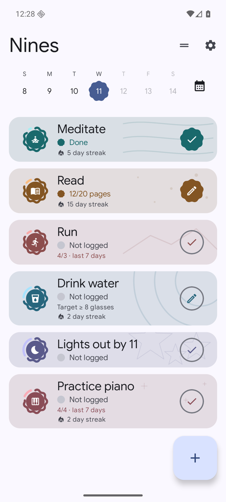
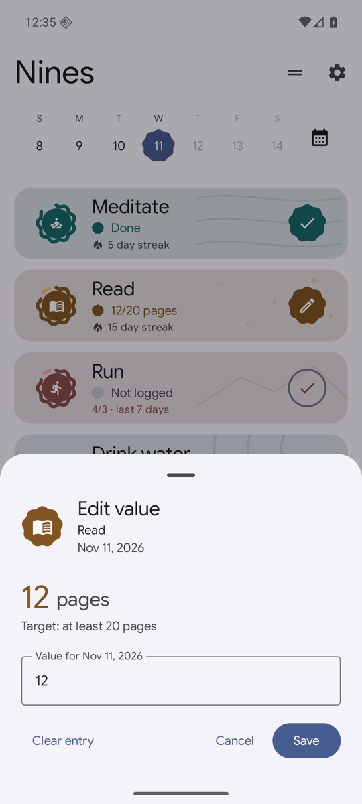
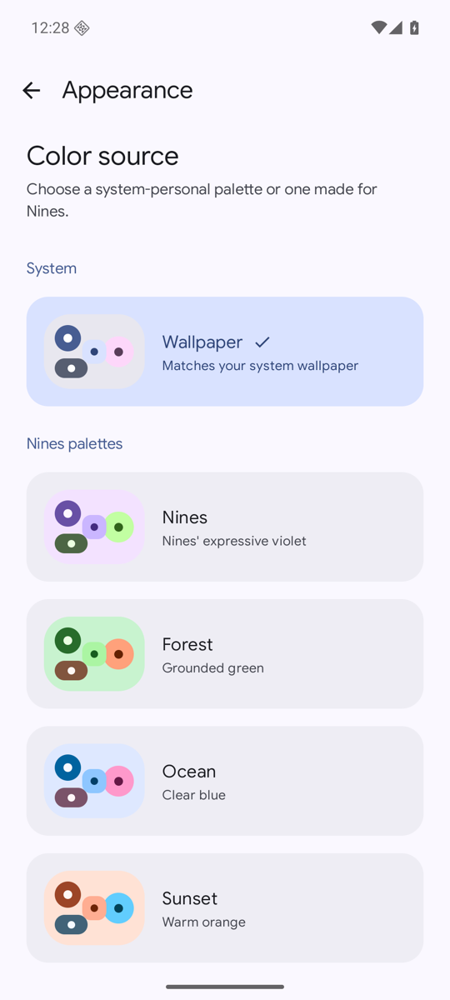

Nines is a habit tracker for Android whose score works like an uptime SLO. Miss a day and you spend part of an error budget that decays over time, instead of watching a streak reset to zero. The score is a moving average over your history, so one bad day dents it and a good week repairs it.

Everything stays on your phone. Nines has no account, no ads, no analytics and no internet permission. It runs on Android 8.0 and later and follows your wallpaper colors with Material 3 Expressive.

<p>



</p>

Left, today's habits with streaks and progress toward each target. Middle, logging a measurable habit against its target. Right, the palette picker.

## What it does

- Yes/no habits and measurable habits with a target, such as 20 pages or 8 glasses.
- Daily, weekly and custom frequencies. Changing a schedule only affects days from then on, so history is never rewritten.
- Browse any past day and log or fix entries there.
- Score, streak and best-streak history, always derived from your entries.
- Reminders with Mark done, Not today and Snooze right from the notification.
- Archive instead of delete. Archived habits keep their history and can be restored.
- Backs up with Android's device backup.

## Install

Nines has no release yet. To try it, build the debug APK below and install it with `adb install app/build/outputs/apk/debug/app-debug.apk`.

## Build

You need the Android SDK (set `ANDROID_HOME` or `sdk.dir` in `local.properties`) and a full JDK 25. GraalVM builds fail: their `jlink` cannot create the Android JDK image.

```sh
./gradlew :app:assembleDebug     # debug APK
./gradlew :app:testDebugUnitTest # unit tests
```

Format with `./gradlew spotlessApply`, run static analysis with `./gradlew :app:detekt`, and enable the pre-commit hook once with `git config core.hooksPath .githooks`. The app needs no environment variables or secrets. Instrumented tests (Room, reminders, UI) run on a device or emulator with `./gradlew :app:connectedDebugAndroidTest`; the `verify-nines` skill in `.agents/skills/` launches the app on an emulator and drives it.

## How it is built

Kotlin, Jetpack Compose with Material 3 Expressive, Room, Koin and Navigation 3, in a single `:app` module. `docs/architecture.md` explains the layout, `GLOSSARY.md` defines the domain terms (Habit, Entry, Schedule, Score, Streak) and `docs/adr/` records the decisions. Planned work is in [GitHub Issues](https://github.com/dhevdotdev/Nines/issues).

## License

Nines is released under the [MIT License](LICENSE).
