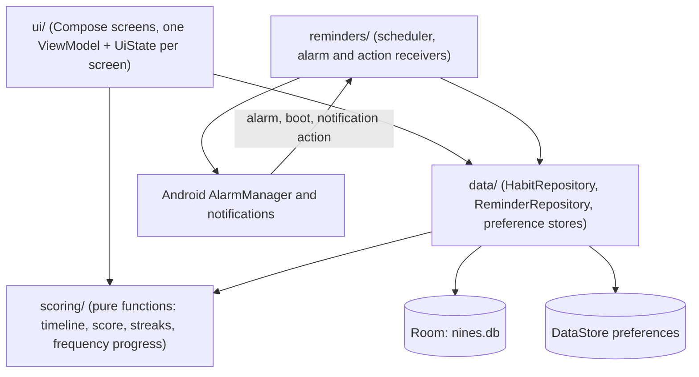

# Architecture

Nines is a single-module Android app (`:app`) plus a `:benchmark` module that generates the baseline profile. Everything runs on the device; there is no backend.

## Layers

- `scoring/` holds the domain rules and has no Android dependencies. A Score, Streak or Gap is always derived from Entries and the Schedule in force on each date, never stored (see `docs/adr/0002-score-and-streaks-are-derived.md`). This is the part of the codebase with a coverage floor in CI.
- `data/` exposes repositories over Room (`data/local/`, entities `Habit`, `ScheduleVersion`, `Entry`, `Reminder`) and DataStore preference stores for appearance, onboarding and reminder settings. The repository emits one date-bounded Habit timeline that the homepage and detail screens both consume.
- `ui/` is Jetpack Compose with Material 3 Expressive. Each screen has a `UiState`, an action type and a ViewModel (`docs/adr/0008-per-screen-uistate-action-pattern.md`). `ui/nav/Routes.kt` defines Navigation 3 routes.
- `reminders/` schedules exact local-time alarms, posts actionable notifications (mark done, not today, snooze) and restores alarms after a reboot.
- `di/AppModule.kt` wires everything with Koin (`docs/adr/0004-koin-over-hilt.md`).

## Data

The Room schema is exported to `app/schemas/` and checked in, so every schema change shows in review. The database currently uses a destructive migration fallback because there is no installed base yet; real migrations are tracked in the issue tracker.
